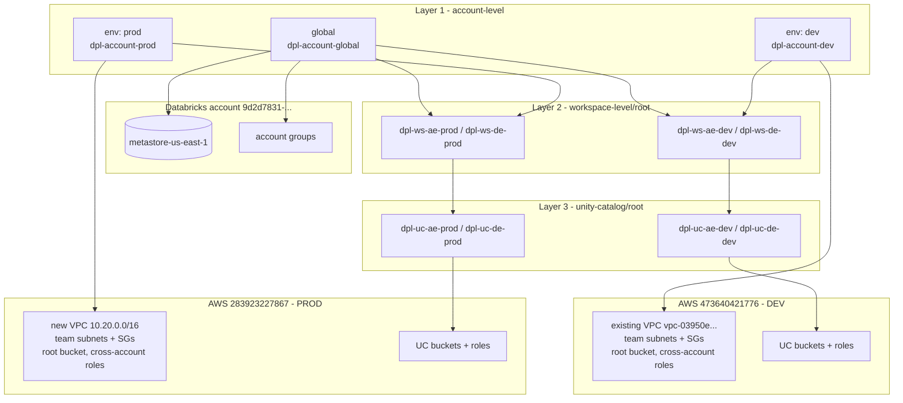
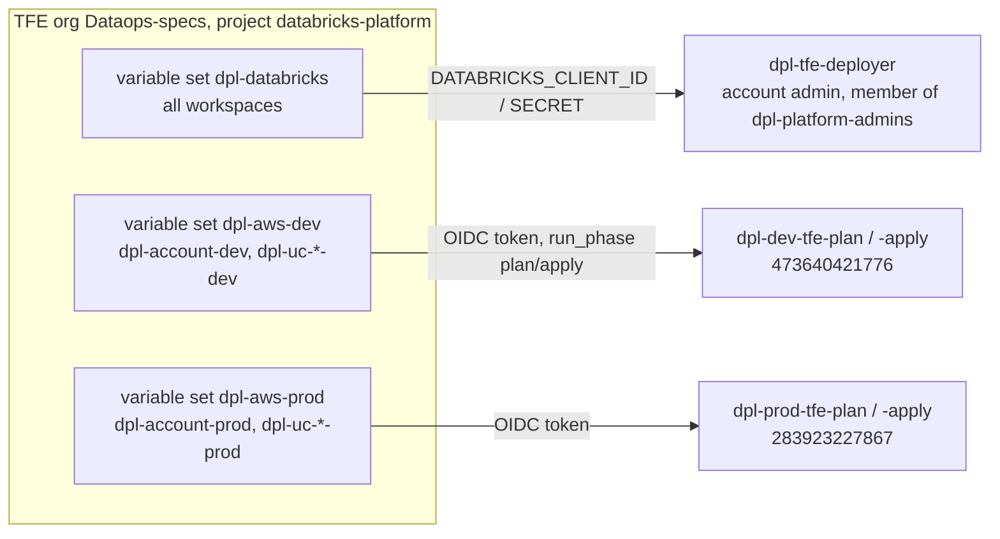
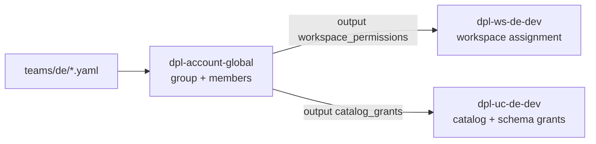

# Architecture

## Layers



| Layer | Root | What it owns | Scope | Databricks API | AWS |
|---|---|---|---|---|---|
| 1 global | `account-level/global` | metastore (lookup), account groups + members from `teams/<team>/<group>.yaml`, deployer membership; publishes each group's workspace permission and catalog grants | platform | account | none |
| 1 env | `account-level/env` | VPC foundation, root bucket + storage configuration; per team: subnets, SG, cross-account role, credential + network configuration | environment | account | one account |
| 2 | `workspace-level/root` | workspace, metastore assignment, workspace access, optional cluster policies | team × env | account (+ workspace for policies) | none |
| 3 | `unity-catalog/root` | UC bucket, IAM role, storage credential, external location, catalogs, schemas, grants, shares | team × env | workspace | one account |

### Why the boundaries are where they are

- **Metastore and groups are in `global`, not in `env`.** There is one metastore per region per Databricks account, and groups are account-wide. Each needs exactly one owner, shared by DEV and PROD.
- **Network and cross-account roles are in `env`, not in the team layers.**
  - The *restricted* cross-account policy names the workspace's VPC and security group, so each team gets its own role, created next to its network.
  - The network config, SG and subnets can't be reused between workspaces.
  - The root bucket and storage configuration are shared by every workspace in the environment.
- **UC storage is in layer 3, not layer 1.** The IAM role's trust policy needs the storage credential's external ID, which only exists once the credential has been created through the workspace. Keeping bucket, role and credential together avoids a loop between states.
- **Workspace and UC are separate states.** A catalog change never risks the workspace, and the UC provider gets a workspace URL that is already known at plan time.

## State

Every TFE workspace holds exactly one state; there are no backend blocks in the code.

| State | Read by |
|---|---|
| `dpl-account-global` | `dpl-ws-*`, `dpl-uc-*` (metastore ID, groups, team list) |
| `dpl-account-<env>` | `dpl-ws-*-<env>` (configuration IDs per team) |
| `dpl-ws-<team>-<env>` | `dpl-uc-*-<env>` (own team: URL/ID/account; other teams: workspace ID for shares) |
| `dpl-uc-<team>-<env>` | nobody |

- **Access is explicit:** `global_remote_state = false`, and each workspace names its consumers (`remote_state_consumer_ids`, generated by `tfe/`).
- **Reading is simple:** reads use `terraform_remote_state` with `backend = "remote"`, so they need no token inside a TFE run.

## Credentials



- **AWS: dynamic credentials, nothing stored.**
  - Each run gets a short-lived token for exactly one role.
  - Role trust is pinned to `organization:Dataops-specs:project:databricks-platform:workspace:<name>:run_phase:<plan|apply>`, and only for `dpl-account-<env>` and `dpl-uc-*-<env>`.
  - `dpl-account-global` and `dpl-ws-*` get no AWS access at all.
- **AWS plan vs apply:**
  - The plan role is `ReadOnlyAccess`.
  - The apply role adds EC2 in `us-east-1`, plus IAM roles/policies, PassRole and S3, all limited to names starting `dpl-<env>-`.
- **Databricks: one OAuth M2M service principal.**
  - It's account admin; the workspace layer makes it ADMIN of every workspace it creates.
  - It's a member of `dpl-platform-admins`, which owns the UC objects and has `CREATE CATALOG / EXTERNAL LOCATION / STORAGE CREDENTIAL` on the metastore.
  - Its secret exists only in the TFE UI.
- **Guards:**
  - account layer: the AWS account must equal `aws_account_id`;
  - unity-catalog layer: the AWS account must equal the workspace layer's account;
  - bootstrap: your sign-in must be the expected account.

## Identities and access: one YAML file per group

```
account-level/global/teams/
├── platform/dpl-platform-admins.yaml
├── de/dpl-dev-de-admins.yaml   dpl-dev-de-engineers.yaml   dpl-dev-de-analysts.yaml   dpl-prod-de-*.yaml
└── ae/...
```

```yaml
# teams/de/dpl-dev-de-analysts.yaml     (file name = group name, folder = team)
environment: dev
members:
  users: [analyst@example.com]
workspace_permission: USER              # on dpl-dev-de
catalog_grants:
  dpl_dev_de:
    privileges: [USE_CATALOG]
    schemas:
      gold: [USE_SCHEMA, SELECT]
```



The YAML is the single source, but each part is applied by the layer that owns the object:
- the group itself does not depend on a workspace;
- workspace access needs the workspace (layer 2);
- grants need the catalog (layer 3).

Rules:
- **The folder decides the team.** A group in `teams/de/` only gets access to DE's workspace and DE's catalogs. Cross-team read access is set by the producing team (`consumers` in its uc tfvars).
- **Platform groups apply everywhere.** Groups under `teams/platform/` (`environment: all`) get their `workspace_permission` on every workspace.
- **Grants are merged.** UC grants from YAML are merged with any `grants` / `schema_grants` in the team's uc tfvars. Use those for principals without a YAML, such as pipeline service principals.
- **Members:**
  - With `manage_members = true` (the default in `global.tfvars`), Terraform owns membership from `members:`, and users must already exist in the Databricks account.
  - With `manage_members = false`, an IdP syncs members through SCIM. Groups the IdP creates use `create: false`.
- **Workspace access** comes from account-level assignments (identity federation), not workspace-local groups.

| Group (example) | Workspace | UC (initial, from YAML) |
|---|---|---|
| `dpl-platform-admins` | ADMIN everywhere | owner of UC objects (`owner_group`) |
| `dpl-dev-de-admins` | ADMIN on `dpl-dev-de` | `ALL_PRIVILEGES` on `dpl_dev_de` (PROD: read) |
| `dpl-dev-de-engineers` | USER | DEV: build (MODIFY, CREATE_*); PROD: read |
| `dpl-dev-de-analysts` | USER | `USE_CATALOG` + gold `USE_SCHEMA, SELECT` |

## Naming

| Thing | Pattern | Example |
|---|---|---|
| TFE workspace | `dpl-account-global`, `dpl-account-<env>`, `dpl-ws-<team>-<env>`, `dpl-uc-<team>-<env>` | `dpl-uc-de-dev` |
| Databricks workspace | `dpl-<env>-<team>` | `dpl-dev-de` |
| Catalog | `dpl_<env>_<team>` (tfvars) | `dpl_prod_ae` |
| Root bucket | `dpl-<env>-root-<account>` | `dpl-dev-root-473640421776` |
| UC bucket / role | `dpl-<env>-<team>-uc-<account>` / `dpl-<env>-<team>-uc-access` | `dpl-dev-de-uc-473640421776` |
| Cross-account role | `dpl-<env>-<team>-crossaccount` | `dpl-prod-ae-crossaccount` |
| TFE roles | `dpl-<env>-tfe-plan`, `dpl-<env>-tfe-apply` | `dpl-dev-tfe-apply` |
| Groups | `dpl-<env>-<team>-<role>` | `dpl-dev-de-engineers` |

## Moving to the client's Terraform Enterprise

The same code runs on self-hosted TFE. Change only these:

| Where | Change |
|---|---|
| `tfe/variables.tf` / `terraform.tfvars` | `tfe_hostname = "<tfe host>"`, `tfe_organization`, `github_app_installation_name = null`, `oauth_token_id = "ot-..."` |
| `tfe/versions.tf` | `cloud { hostname = "<tfe host>" organization = "<org>" ... }` |
| `bootstrap/aws-oidc/*.tfvars` | `tfe_hostname`, `tfe_organization` |

Check two things on their side:
- **Version:** TFE v202306-1 or newer, for dynamic credentials.
- **Reachability:** AWS must reach `https://<tfe host>/.well-known/openid-configuration` from the internet. If it can't, use TFE agents in each AWS account with an instance role instead of OIDC.
