# Getting started

First-time setup for **your** environment, from an empty GitHub repo to running workspaces. Commands are **Windows PowerShell**.

| Item | Value |
|---|---|
| TFE / HCP Terraform org | `Dataops-specs` (https://app.terraform.io/app/Dataops-specs) |
| GitHub repo | `brata-spec/dataops-databricks-platform` |
| Databricks account | `9d2d7831-b28c-43e4-9b91-bd859a24185a` |
| DEV AWS account | `473640421776`, existing VPC `vpc-03950e5934415cd3c` |
| PROD AWS account | `283923227867`, new VPC `10.20.0.0/16` |
| Region | `us-east-1` |
| Existing metastore | `metastore-us-east-1` (looked up, not created) |
| Teams | `ae`, `de` |
| Branches | `develop` -> DEV workspaces, `main` -> PROD workspaces and `dpl-account-global` |

```mermaid
flowchart LR
  S0[0 Tools] --> S1[1 Databricks SP] --> S2[2 GitHub repo] --> S3[3 TFE + GitHub App]
  S3 --> S4[4 dpl-tfe-admin] --> S5[5 apply tfe/] --> S6[6 paste secret]
  S6 --> S7[7 AWS OIDC bootstrap] --> S8[8 dpl-account-global] --> S9[9 metastore grant]
  S9 --> S10[10 DEV chain] --> S11[11 PROD chain] --> S12[12 branch protection]
```



---

## 0. Tools and access

```powershell
winget install Hashicorp.Terraform      # >= 1.11
winget install Git.Git
winget install GitHub.cli
winget install Amazon.AWSCLI
terraform version; git --version; gh --version; aws --version
```

You need these accesses:

- **Databricks:** account admin.
- **AWS:** admin sign-in to **both** accounts through IAM Identity Center (SSO). Don't create access keys.
- **TFE / HCP Terraform:** owner of `Dataops-specs`.
- **GitHub:** admin of `brata-spec`.

Set up an SSO profile for each account. This is a one-time step; answer the prompts with your SSO start URL, the account, and an admin role:

```powershell
aws configure sso --profile dpl-dev     # account 473640421776
aws configure sso --profile dpl-prod    # account 283923227867
aws sso login --profile dpl-dev
aws sts get-caller-identity --profile dpl-dev
```

Check two things before you start:

- **PROD SCP:** if `283923227867` is a member account of an AWS Organization, its service control policies must allow EC2/VPC, S3, IAM and STS in `us-east-1`. Ask the org admin, or run `aws ec2 describe-vpcs --profile dpl-prod`. A `with an explicit deny in a service control policy` message means the SCP is blocking.
- **Existing OIDC provider:** see whether either account already trusts `app.terraform.io`. If it does, set `create_oidc_provider = false` in step 7.

  ```powershell
  aws iam list-open-id-connect-providers --profile dpl-dev
  aws iam list-open-id-connect-providers --profile dpl-prod
  ```

## 1. Databricks deployer service principal

TFE runs as one service principal. Create it once by hand; everything else is Terraform.

1. In the Account Console, go to **User management → Service principals → Add service principal** and name it `dpl-tfe-deployer`.
2. Open the SP's **Roles** tab and turn on **Account admin**. It needs this to create workspaces and groups.
3. Open the **Secrets** tab and click **Generate secret**. Copy the **Client ID** and **Secret**.
   - The secret is shown once. Keep it in your password manager only.
   - Don't put it in a file, a commit, or a chat. You paste it into the TFE UI in step 6.
4. Note the **Application (Client) ID**. It's not a secret, so it can go in `tfe/terraform.tfvars`.
5. Under **Catalog**, check that the metastore in `us-east-1` is called `metastore-us-east-1`. If it isn't, change `metastore.name` in `account-level/global/global.tfvars`.

## 2. GitHub repository

Unzip the repo to, for example, `C:\work\dataops-databricks-platform`, then:

```powershell
cd C:\work\dataops-databricks-platform
git init -b main
git add .
git commit -m "Databricks platform: initial layout"
gh auth login
gh repo create brata-spec/dataops-databricks-platform --private --source . --remote origin --push

# DEV workspaces track develop: it must exist before step 5
git switch -c develop
git push -u origin develop
git switch main
```

Leave branch protection until step 12, because the TFE status checks only appear after the first PR.

## 3. Connect TFE to GitHub

`tfe/` attaches every workspace to the repo through the **HCP Terraform GitHub App**.

1. In HCP Terraform, install the GitHub App on the `brata-spec` account and give it access to `dataops-databricks-platform`. You can start the install from the organization's VCS settings, or by starting **New workspace → Version control workflow → GitHub.com** and cancelling after the app is installed.
2. Authorize your HCP user for the app if you're asked to. `tfe/` looks up the installation by name (`brata-spec`) using your token.

If you use an OAuth VCS provider instead (common on self-hosted Terraform Enterprise):
- Create it under **Organization settings → Version control → Providers**.
- In `tfe/terraform.tfvars`, set `github_app_installation_name = null` and `oauth_token_id = "ot-..."`.

## 4. Admin workspace `dpl-tfe-admin` (by hand, once)

`tfe/` needs somewhere to keep its own state before it can create anything.

1. Go to **Workspaces → New → Workspace → CLI-driven workflow**, name it `dpl-tfe-admin`, and put it in the **Default Project**.
2. In **Settings → General → Execution Mode**, choose **Local**, then **Save**.

## 5. Create the platform side of TFE (`tfe/`)

```powershell
terraform login                       # browser -> token stored in %APPDATA%\terraform.d
cd C:\work\dataops-databricks-platform\tfe
Copy-Item terraform.tfvars.example terraform.tfvars
notepad terraform.tfvars              # set deployer_application_id (client ID from step 1)
terraform init
terraform plan
terraform apply
```

This creates:
- the `databricks-platform` and `databricks-platform-admin` projects;
- **11 VCS workspaces**, plus `dpl-bootstrap-aws-dev` and `dpl-bootstrap-aws-prod`;
- the variable sets `dpl-databricks`, `dpl-aws-dev` and `dpl-aws-prod`;
- 12 run triggers, and the state-sharing rules.

`terraform output` lists all of it. No runs start yet, because `queue_all_runs = false`.

## 6. Paste the Databricks secret (UI only)

Go to **Organization settings → Variable sets → `dpl-databricks` → `DATABRICKS_CLIENT_SECRET` → Edit**, paste the secret from step 1, and save. It stays sensitive and write-only. Terraform ignores the value (`ignore_changes`), so re-applying `tfe/` never overwrites it.

## 7. AWS OIDC trust (`bootstrap/aws-oidc`, once per account)

Each run creates three things in one account:
- the OIDC provider for `app.terraform.io`;
- `dpl-<env>-tfe-plan` (read-only);
- `dpl-<env>-tfe-apply`.

Both roles trust only `dpl-account-<env>` and `dpl-uc-*-<env>` in project `databricks-platform`.

```powershell
cd C:\work\dataops-databricks-platform\bootstrap\aws-oidc
$env:TF_CLOUD_ORGANIZATION = "Dataops-specs"

# DEV
aws sso login --profile dpl-dev
$env:AWS_PROFILE  = "dpl-dev"
$env:TF_WORKSPACE = "dpl-bootstrap-aws-dev"
terraform init
terraform apply -var-file="dev.tfvars"     # add  -var="create_oidc_provider=false"  if step 0 found one

# PROD
aws sso login --profile dpl-prod
$env:AWS_PROFILE  = "dpl-prod"
$env:TF_WORKSPACE = "dpl-bootstrap-aws-prod"
terraform init -reconfigure
terraform apply -var-file="prod.tfvars"

Remove-Item Env:TF_WORKSPACE, Env:AWS_PROFILE
```

A guard stops the run if `AWS_PROFILE` points at the wrong account. The role ARNs are already in the `dpl-aws-dev` and `dpl-aws-prod` variable sets, because `tfe/` built them from the same names.

## 8. First run: `dpl-account-global`

First add yourself to the platform group: put your Databricks user name under `members.users` in `account-level/global/teams/platform/dpl-platform-admins.yaml`, commit, and push to `main`. Do the same for team members in `teams/<team>/*.yaml`. Users must already exist in the Databricks account (Account Console → User management), because Terraform looks them up and doesn't create them.

In TFE, open **Projects → databricks-platform → `dpl-account-global` → New run → Plan and apply → Start**. Review the plan, which should show:
- a lookup of the existing metastore;
- 13 groups, one per YAML file: `dpl-platform-admins` and `dpl-dev-ae-admins` … `dpl-prod-de-analysts`;
- their members;
- the deployer SP joining `dpl-platform-admins`.

Then **Confirm & apply**.

**Expected side effect:** run triggers queue all four `dpl-ws-*` workspaces. Their plans **fail** with:

```
Team 'ae' has no network in dpl-account-dev ...
```

That's the dependency guard working: the account level doesn't exist yet. Ignore these runs. They succeed once step 10 triggers them again.

## 9. Let the platform group create Unity Catalog objects

The UC layer creates storage credentials, external locations and catalogs as the deployer SP, which is now in `dpl-platform-admins`. The metastore must allow that. A **metastore admin** runs this SQL in any workspace attached to `metastore-us-east-1`, using a SQL editor or notebook:

```sql
GRANT CREATE CATALOG, CREATE EXTERNAL LOCATION, CREATE STORAGE CREDENTIAL
ON METASTORE TO `dpl-platform-admins`;
```

As an alternative, make `dpl-platform-admins` the metastore admin: **Account Console → Catalog → metastore-us-east-1 → Metastore admin → Edit**.

## 10. DEV chain

Start a run on **`dpl-account-dev`** and confirm it. Account level is manual even in DEV. It creates, in `vpc-03950e5934415cd3c`:
- 4 subnets and 2 security groups;
- the root bucket `dpl-dev-root-473640421776`;
- 2 cross-account roles;
- the Databricks storage, credential and network configurations.

After that the run triggers handle the rest, with no clicks needed, because DEV auto-applies:

```
dpl-account-dev ──► dpl-ws-ae-dev ──► dpl-uc-ae-dev
                └─► dpl-ws-de-dev ──► dpl-uc-de-dev
```

- **`dpl-ws-*-dev`:**
  - the workspaces `dpl-dev-ae` and `dpl-dev-de`, which take 5–10 minutes each;
  - their metastore assignment and group access;
  - DE's `job-compute` cluster policy.
- **`dpl-uc-*-dev`:**
  - the UC bucket, IAM role, storage credential and external location;
  - catalog `dpl_dev_<team>` with `bronze`, `silver` and `gold` schemas, plus grants.

On the free tier, runs queue one at a time.

If `dpl-uc-de-dev` finishes before `dpl-ws-ae-dev`, DE's read-only share of `gold` to AE is postponed. You'll see a check warning saying "Read-only share pending for: dpl_dev_de/ae". Start another run on `dpl-uc-de-dev` after AE's workspace exists.

**Check the result:**
- The `workspace_url` output of `dpl-ws-de-dev` opens the workspace.
- **Catalog** shows `dpl_dev_de` with three schemas.
- Members of `dpl-dev-de-engineers` can create tables in it.

## 11. PROD chain

`main` already holds the same code. Confirm each layer in order:
1. Start a run on **`dpl-account-prod`** and confirm. It creates the new VPC, NAT, S3 endpoint, subnets, roles and configurations.
2. The run triggers queue `dpl-ws-ae-prod` and `dpl-ws-de-prod`. Open each and **Confirm & apply**.
3. That queues `dpl-uc-ae-prod` and `dpl-uc-de-prod`. Confirm each.

## 12. Branch protection

Do this after you've opened one PR into each branch, so the TFE status checks are visible. In GitHub, go to **Settings → Branches** (or **Rules → Rulesets**) and set up `main` and `develop`:
- [x] Require a pull request before merging, with review from Code Owners.
- [x] Require status checks to pass: add the `Terraform Cloud/Dataops-specs/dpl-…` checks you want to enforce. At minimum, add the workspaces of the layer the PR touches.
- [x] Block force pushes and deletions.

Then replace `@brata-spec` in `.github/CODEOWNERS` with real teams if you have them.

---

**Next:** day-to-day changes are in [workflow.md](workflow.md). If something fails, see [troubleshooting.md](troubleshooting.md).
