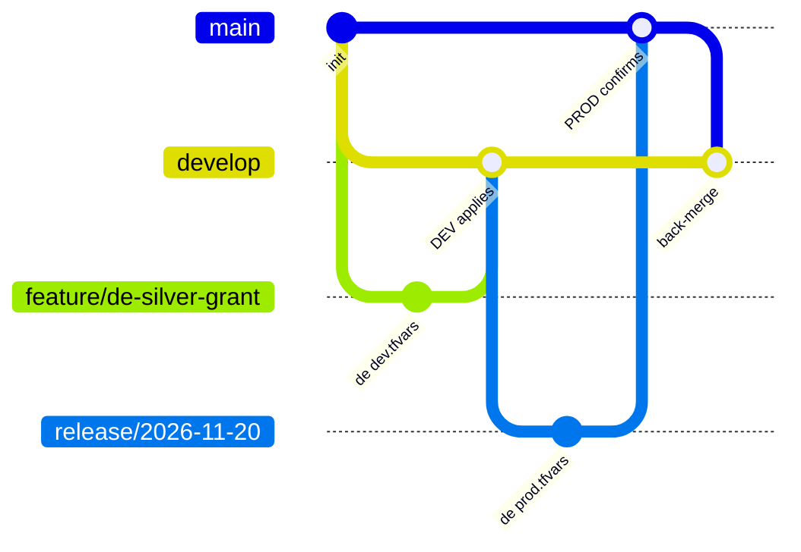
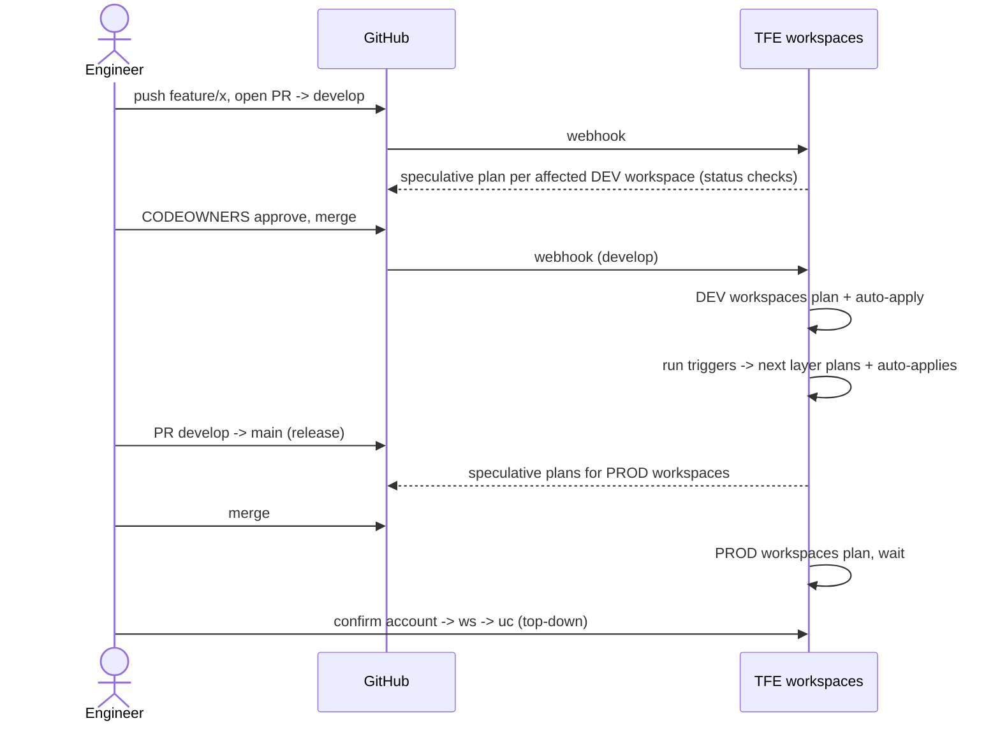
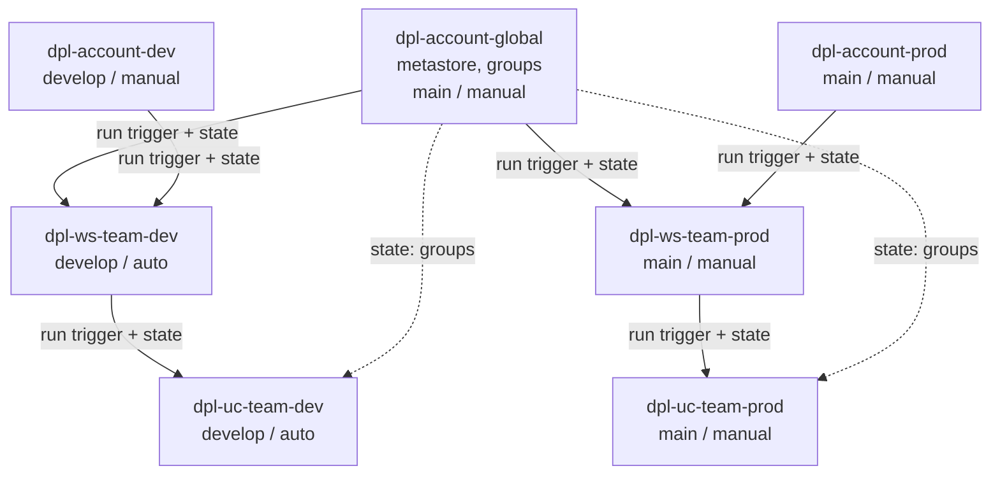

# Workflow

How changes move from a feature branch to DEV and then PROD, how the layers wait for each other, and what to do in 14 common scenarios.

## 1. Branches



| Branch | Tracked by | Apply |
|---|---|---|
| `feature/*` | nobody: PR plans only | never |
| `develop` | `dpl-account-dev`, `dpl-ws-*-dev`, `dpl-uc-*-dev` | ws/uc auto, account manual |
| `main` | `dpl-account-global`, `dpl-account-prod`, `dpl-ws-*-prod`, `dpl-uc-*-prod` | manual (confirm) |

- **Feature branches only get speculative plans.** TFE runs them for PRs into the branch a workspace tracks:
  - a PR into `develop` gets DEV plans;
  - a PR into `main` gets PROD and global plans.
- **Code reaches PROD only through `develop → main`.** That way every root or module change has run in DEV first.
- **`account-level/global` is the exception.** It's shared by both environments, so it tracks `main` (scenario 5).

## 2. Life of a change



**Trigger paths keep runs narrow.** A workspace only runs when its own files change:

| Workspace | Runs when these change |
|---|---|
| `dpl-account-global` | `account-level/global/**` (incl. `teams/*/*.yaml`), `modules/metastore/**`, `modules/user-management/**` |
| `dpl-account-<env>` | `account-level/env/*.tf`, `account-level/env/<env>.tfvars`, `modules/aws-account/**` |
| `dpl-ws-<team>-<env>` | `workspace-level/root/**`, `workspace-level/<team>/<env>.tfvars`, `modules/databricks-workspace/**`, `modules/workspace-assignment/**`, `modules/cluster-policies/**` |
| `dpl-uc-<team>-<env>` | `unity-catalog/root/**`, `unity-catalog/<team>/<env>.tfvars`, `modules/unity-catalog/**` |

So editing `unity-catalog/de/dev.tfvars` runs only `dpl-uc-de-dev`.

## 3. Dependencies between layers



Three guards keep the order:

1. **Run triggers decide what runs next.** A downstream workspace is queued only after an upstream apply **succeeds and changes something**. If the upstream fails, nothing below it runs. DEV run-triggered runs auto-apply; PROD ones wait for a confirm.
2. **Remote state plus preconditions are the safety net.** Each layer reads its upstream outputs and checks them at **plan**, before anything is created:
   - **workspace layer:** the team is in `dpl-account-global`, the team has a network in `dpl-account-<env>`, and every group it assigns exists;
   - **unity-catalog layer:** its workspace exists for the same team and environment, the AWS credentials match the environment's account, and `owner_group` exists.
3. **Terraform's graph orders things inside a layer:**
   - workspace layer: workspace → metastore assignment → group/SP assignment → 60 s wait → cluster policies;
   - unity-catalog layer: bucket → role → credential → external location → catalogs → schemas → grants → shares.

## 4. Rules

1. **One layer per PR.** A PR that touches two layers makes both start at the same time on merge, and the lower one plans against the old outputs of the upper. Check with `./scripts/validate.sh --pr develop`.
2. **Global first.** Changes to `account-level/global` (groups, metastore) go by PR into `main`. Apply them, then merge `main` back into `develop`.
3. **PROD top-down.** After a release merge, confirm `dpl-account-prod`, then the `dpl-ws-*-prod` workspaces, then the `dpl-uc-*-prod` workspaces. **Discard** a downstream run that started before its upstream applied, and confirm the run its run trigger queues instead.
4. **Teams edit tfvars only.** Changes under `root/`, `modules/`, `tfe/` and `bootstrap/` go through the platform team.
5. **New optional features are off by default.** A new module in a shared root gets a variable whose default is "off", and teams switch it on in their own tfvars (scenario 6).

---

## 5. Scenarios

### Scenario 1: change a grant in DEV (one team, one layer)

```powershell
git switch develop; git pull
git switch -c feature/de-dev-silver-read
notepad unity-catalog\de\dev.tfvars      # e.g. add  silver = { "dpl-dev-de-analysts" = ["USE_SCHEMA","SELECT"] }  under schema_grants
.\scripts\validate.sh --pr develop       # in Git Bash: ./scripts/validate.sh --pr develop
git commit -am "DE dev: analysts read silver"
git push -u origin HEAD
gh pr create --base develop --fill
```

1. The PR shows a plan for **`dpl-uc-de-dev` only**, e.g. `1 to add` (a `databricks_grant`).
2. Once CODEOWNERS approves, merge. `dpl-uc-de-dev` auto-applies.
3. Nothing else runs.

### Scenario 2: promote DEV changes to PROD (release)

1. Put the PROD values on `develop` first, via a feature PR: edit `unity-catalog/de/prod.tfvars`. PR plans into `develop` only show DEV workspaces, so the PROD plan comes in step 3.
2. Open the release PR: `gh pr create --base main --head develop --title "Release 2026-11-20"`.
3. The PR checks show speculative plans for the affected **PROD** workspaces, e.g. `dpl-uc-de-prod`. Review them.
4. Merge, then in TFE confirm the queued PROD runs **top-down** (account → ws → uc). Only the workspaces whose files changed are queued.

### Scenario 3: add a catalog or schema for a team

Edit `unity-catalog/<team>/<env>.tfvars` and add an entry under `catalogs` or `schemas`, then follow scenario 1 (DEV) and scenario 2 (PROD).
- Catalog names must be lowercase with underscores.
- New schemas are created with `force_destroy = false`, so removing a schema that still holds tables fails safely.

### Scenario 4: add a new team (`analytics`)

| Step | Branch | Change | Applies |
|---|---|---|---|
| 1 | local | `tfe/variables.tf` (or `tfe/terraform.tfvars`): `teams = ["ae", "de", "analytics"]`, then `terraform apply` in `tfe/` | creates `dpl-ws-analytics-{dev,prod}` and `dpl-uc-analytics-{dev,prod}`, adds `analytics` to `var.teams` on global and to `expected_teams` on the account workspaces, wires triggers and sharing |
| 2 | PR → `main` | add `account-level/global/teams/analytics/` with one YAML per group (copy `teams/ae/`, rename files and catalog names), then back-merge `main` into `develop` | confirm `dpl-account-global`: creates the groups + members |
| 3 | PR → `develop` | `account-level/env/dev.tfvars`: add `analytics = { new_subnets = {...} }` with free CIDRs | confirm `dpl-account-dev` → triggers `dpl-ws-*-dev` |
| 4 | PR → `develop` | create `workspace-level/analytics/dev.tfvars` (copy `ae/dev.tfvars`, change group names) | `dpl-ws-analytics-dev` auto-applies → triggers `dpl-uc-analytics-dev` |
| 5 | PR → `develop` | create `unity-catalog/analytics/dev.tfvars` | `dpl-uc-analytics-dev` auto-applies |
| 6 | PR → `develop` | `account-level/env/prod.tfvars`, `workspace-level/analytics/prod.tfvars`, `unity-catalog/analytics/prod.tfvars` (one PR per layer) | DEV workspaces only, no PROD effect yet |
| 7 | release `develop → main` | | confirm `dpl-account-prod` → `dpl-ws-analytics-prod` → `dpl-uc-analytics-prod` |

`validate.sh` fails until both folders and both account tfvars entries exist for `analytics`.

Note on step 1: until step 3 is done, `dpl-account-dev` plans fail its `team_check`, with "dev.tfvars has no network for team(s): analytics". That's the intended guard. Do step 3 next.

### Scenario 5: add a group, add a member, or change a group's access

Every group is one file: `account-level/global/teams/<team>/<group-name>.yaml` (see `teams/README.md`).

```yaml
# account-level/global/teams/de/dpl-dev-de-stewards.yaml
environment: dev
members:
  users: [steward1@example.com, steward2@example.com]
workspace_permission: USER
catalog_grants:
  dpl_dev_de:
    privileges: [USE_CATALOG, BROWSE]
    schemas:
      gold: [USE_SCHEMA, SELECT]
```

1. Branch from `main` and add or edit the YAML. For a new member, add one line under `members.users`; the user must already exist in the Databricks account.
2. Open a PR **into `main`**, because `dpl-account-global` tracks `main`. The plan shows the group and member changes.
3. Merge, then confirm `dpl-account-global`. It creates the group and its members.
4. Run triggers queue `dpl-ws-*`. `dpl-ws-de-dev` (auto-applies) gives the new group `USER` on the workspace. The PROD ws workspaces queue as well; with a DEV group they plan "No changes", so discard or confirm them.
5. **Catalog grants** are applied by `dpl-uc-de-dev`. Start a run on it (**New run**), or let it happen with the team's next catalog change.
6. Merge `main` back into `develop`: `gh pr create --base develop --head main --title "Back-merge global"`.

A member-only change (step 1) touches only `dpl-account-global`. The ws plans show "No changes".

**Renaming** a group (the file name) destroys it and creates a new one. Its workspace assignments and UC grants disappear until downstream re-applies. Add the new file first, move references over, then delete the old file in a separate PR.

**Removing** a group: delete its YAML. Global removes the group; the next ws and uc runs remove its workspace assignment and grants.

**Membership owned by an IdP:** if Entra ID or Okta syncs members (SCIM), set `manage_members = false` in `global.tfvars`. Leave `members:` empty, and use `create: false` for groups the IdP creates.

### Scenario 6: a new optional module for one team only (e.g. workspace-scoped feature for DE)

The roots are shared, so the module must be **off by default**:

1. **Platform PR → `develop`.** Add the module call to `workspace-level/root/main.tf` with `count = length(var.<feature>) > 0 ? 1 : 0`, and declare `variable "<feature>"` with `default = {}`. That's exactly how `cluster_policies` works today.
2. The PR plans **every** `dpl-ws-*-dev` workspace. All of them must show **No changes**: that proves AE is unaffected.
3. **DE PR → `develop`.** Set `<feature> = {...}` in `workspace-level/de/dev.tfvars`. Only `dpl-ws-de-dev` changes.
4. Release to PROD later. PROD ws workspaces plan "No changes" until `de/prod.tfvars` switches the feature on.

**What breaks other teams:**
- **A variable without a default:** the plan fails with `No value for required variable`.
- **Wrapping an existing resource in `count`/`for_each` without a `moved` block:** Terraform plans destroy-and-recreate in every team.

### Scenario 7: change shared code (root or module)

Example: a new output, or a provider version bump in `unity-catalog/root`.
- PR → `develop`. Every workspace using that root plans: 2 teams means 2 DEV plans, 10 teams means 10.
- Review that the plans for teams the change wasn't meant for show **No changes**.
- After merge, DEV applies everywhere. PROD follows through the release PR, confirming each workspace.

On HCP Free (1 concurrent run) the runs queue one after another.

### Scenario 8: account-level network change (e.g. more subnets for a team)

1. PR → `develop` editing `account-level/env/dev.tfvars`. The plan shows `dpl-account-dev` only.
2. Merge and confirm `dpl-account-dev`. Run triggers re-run every `dpl-ws-*-dev`.
3. A changed network configuration updates the workspace in place where Databricks allows it. Read the ws plan for **replace** (`-/+`) before applying. Replacing a workspace deletes it, so stop if you see one.

### Scenario 9: hotfix in PROD

Use this when something must change in PROD before the next release:
1. Branch `hotfix/x` **from `main`**, fix it in the PROD tfvars, then PR → `main`.
2. Merge and confirm the PROD runs top-down.
3. Merge `main` back into `develop` right away, so the next release doesn't undo the fix.

### Scenario 10: a run failed in the middle of the chain

| Symptom | Meaning | Do |
|---|---|---|
| ws plan: `Team 'x' has no network in dpl-account-<env>` | upstream not applied yet, or team missing | apply `dpl-account-<env>` or add the team (scenario 4) |
| ws plan: `Group(s) not managed by dpl-account-global` | group used before it exists | scenario 5 first |
| uc plan: `dpl-ws-x-<env> has no workspace yet` | uc ran before ws | apply `dpl-ws-x-<env>`; its run trigger re-queues uc |
| uc plan: `AWS credentials point at ...` | wrong variable set on the workspace | check `dpl-aws-<env>` attachment in `tfe/` |
| apply failed half-way | partial resources are in state | fix the cause, start a new run: Terraform continues from state |

Nothing downstream ran, because run triggers only fire after a **successful** apply.

### Scenario 11: roll back

- **Code or values:** revert the commit (`git revert <sha>`) through the normal PR flow. TFE applies the previous values.
- **State:** each workspace keeps every state version (**States** tab). Roll back state only on HashiCorp's advice. Normally a revert-and-apply is the right fix.

### Scenario 12: share a catalog with another team

In the **producer's** `unity-catalog/<team>/<env>.tfvars`:

```hcl
consumers = {
  ae = { groups = ["dpl-dev-ae-engineers", "dpl-dev-ae-analysts"], schemas = ["gold"] }
}
```

The producer's uc workspace reads the consumer's workspace ID from `dpl-ws-ae-<env>`. It then adds a **read-only** binding plus `USE_CATALOG`, `USE_SCHEMA` and `SELECT`. If the consumer's workspace doesn't exist yet, a check warning says the share is pending, and the next run adds it.

### Scenario 13: remove a team

Work from the bottom up, PROD and DEV separately:

1. **Delete the team's catalogs:** remove the `catalogs` entries in `unity-catalog/<team>/<env>.tfvars`. Schemas that still hold tables refuse to drop, so empty them first.
2. **Destroy the remaining workspace resources.** For DEV, run a destroy on `dpl-uc-<team>-dev`, then on `dpl-ws-<team>-dev` (**Settings → Destruction and Deletion → Queue destroy plan**). PROD workspaces have destroy plans disabled. Re-enable them deliberately in `tfe/` for this one change.
3. **Remove the network:** delete the team from `account-level/env/<env>.tfvars`.
4. **Retire the workspaces and groups:** remove the team from `tfe/` `teams`, apply `tfe/` to delete its TFE workspaces, then apply `dpl-account-global`, which removes its groups.

### Scenario 14: try a change from your laptop

You can run a speculative plan against the real workspace and state without pushing:

```powershell
terraform login
cd unity-catalog\root
@'
terraform {
  cloud {
    organization = "Dataops-specs"
    workspaces { name = "dpl-uc-de-dev" }
  }
}
'@ | Set-Content zz_local_cloud.tf     # gitignored
terraform init
terraform plan                          # runs in TFE with the workspace's variables, var-file and credentials
Remove-Item zz_local_cloud.tf
```

TFE refuses `apply` from the CLI on VCS-driven workspaces, so this is safe.
